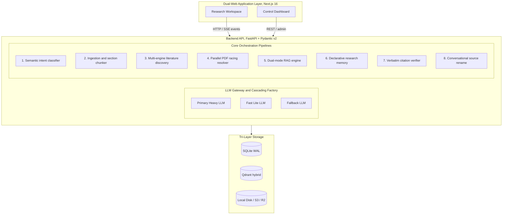
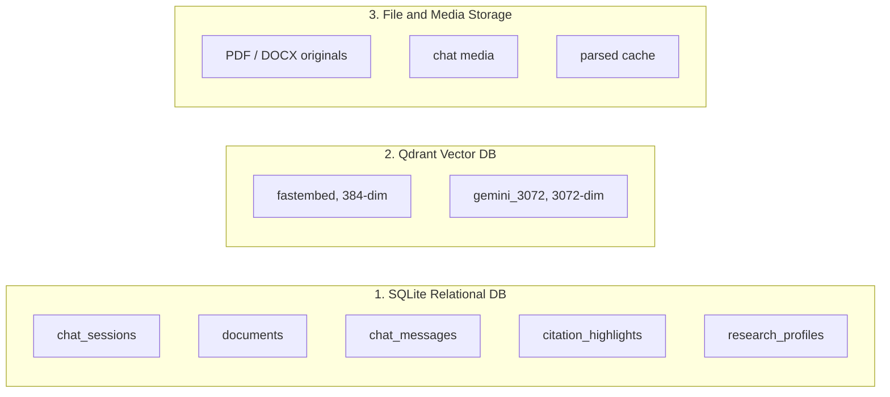
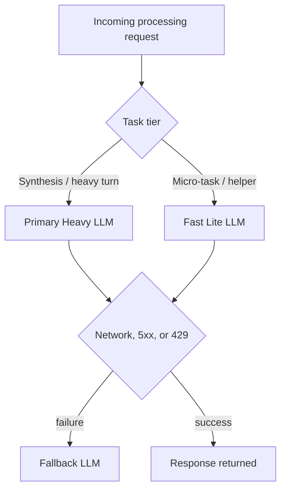
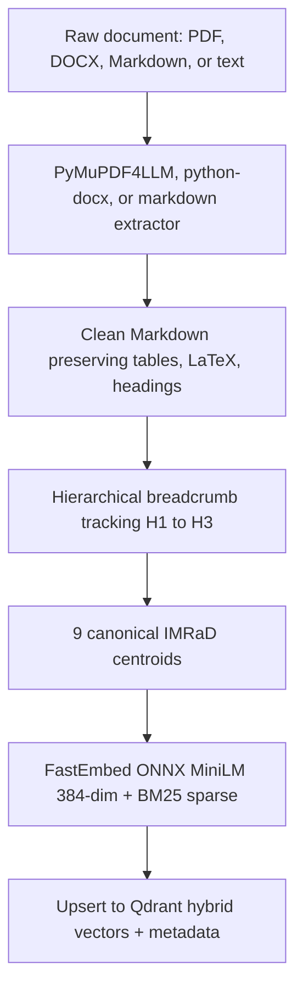
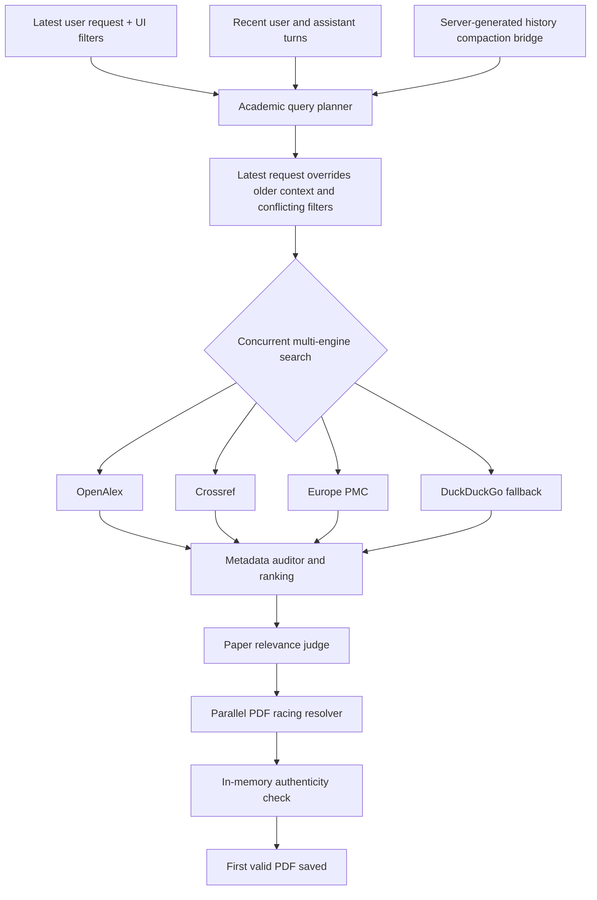
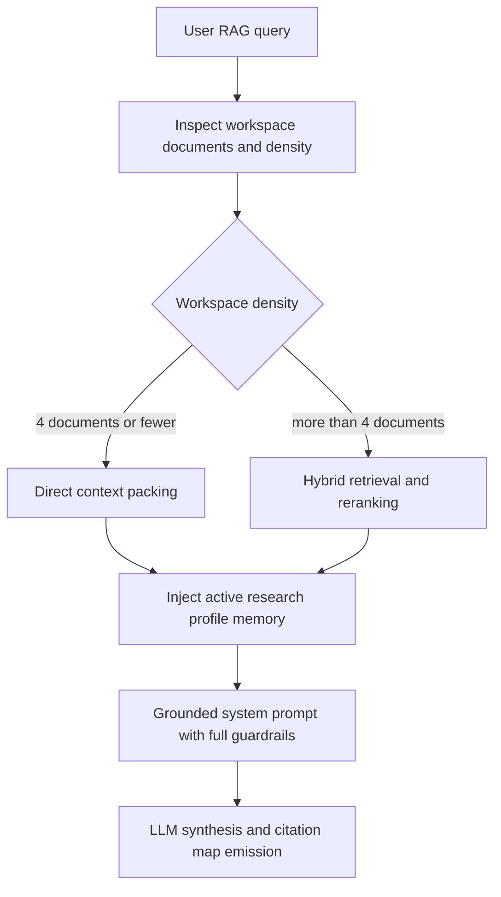
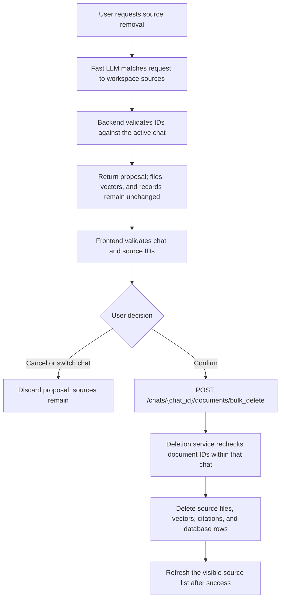
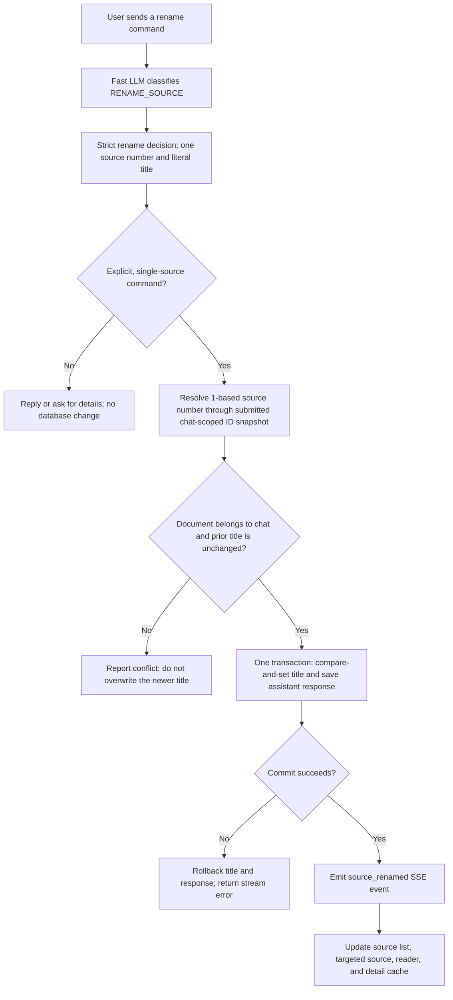

# Technical Stack, Data Stores & System Pipeline Specification

Comprehensive technical specification document for **Not-NotebookLM**: an academic AI Workspace & Research Assistant powered by verifiable scientific Retrieval-Augmented Generation (RAG). This document details the system architecture, core technology stack components, orchestration pipelines (ingestion, discovery, retrieval, synthesis), Fast LLM micro-tasks, storage and database mechanics, and evaluation guardrails.

---

## 1. High-Level System Architecture

Not-NotebookLM is built on a decoupled architecture separating the **User Research Workspace** from the **Management Control Plane**, backed by a headless Vector Database and pluggable Hybrid Object Storage:



Notes the diagram does not carry:
- The workspace is the primary research surface; the Control Dashboard is a separate administrative plane (bare-metal default ports 2026/2027, auto-incremented on collision).
- The workspace exposes the split-pane reader, SSE chat, model switcher, discovery modal, research memory, and inline highlight badges. The dashboard exposes the gateway vault, storage switcher, visibility toggles, secret managers, embedding engine selector, and live health telemetry.
- A per-chat model override can rebind the Primary model for a single session without changing global configuration.
- Model tiers: Primary (16k output, 120s timeout), Fast (4k output, 45s timeout), Fallback (automatic failover).
- The input context window is dynamic and auto-detected via `backend/rag/token_budget.py` rather than fixed at configuration time.

---

## 2. Core Technology Stack Matrix

| Layer / Domain | Technology Component | Version / Specification | Architectural Purpose & Rationale |
| :--- | :--- | :--- | :--- |
| **Frontend Framework** | Next.js (App Router) | `16.3.1` (React 19, Turbopack) | Server-side rendering (SSR), high-performance client state hydration, zero-flicker SSE listeners. |
| **Backend Web API** | FastAPI | `0.141.1` | Asynchronous REST server, automatic validation via Pydantic v2, native SSE streaming. |
| **Styling & Design** | Tailwind CSS | `v4` (`@tailwindcss/postcss`) | Modern atomic CSS layout, custom design tokens, zero-runtime bloat. |
| **State Management** | Zustand | `5.0.15` | Lightweight client-side state management, non-boilerplate for documents, chat state, and UI. |
| **Scientific Math** | KaTeX + Remark/Rehype | `katex 0.18`, `remark-math 6`, `rehype-katex 7` | Renders mathematical formulas and LaTeX scientific equations in reader and chat. |
| **Markdown Engine** | react-markdown | `10.1.0` + `remark-gfm` | Renders GitHub Flavored Markdown, tables, checklists, and blockquotes. |
| **RAG Orchestrator** | LlamaIndex Core | `>= 0.11.0` | Document abstraction, vector store index, retriever nodes, dynamic chat messages. |
| **LLM Gateway Client**| `llama-index-llms-openai-like` | `>= 0.2.0` | Connects to OpenAI-compatible gateways (9Router, LiteLLM, Ollama, OpenRouter). |
| **Vector Database** | Qdrant Client | `>= 1.12.0` | High-performance vector database, compatible with remote servers or embedded disk persistence. |
| **Dense Semantic Embedding** | FastEmbed ONNX | `sentence-transformers/paraphrase-multilingual-MiniLM-L12-v2` (384 dim) | Default local offline dense embeddings (50+ languages), zero external API cost, 100% CPU-native via ONNX Runtime (Zero-PyTorch). |
| **Alternative Embedding** | Google GenAI | `models/gemini-embedding-001` (3072 dim) | High-accuracy Google cloud embedding via `llama-index-embeddings-google-genai` (auto-routed to `not_notebooklm_gemini_3072`). |
| **Sparse Lexical BM25** | FastEmbed | `>= 0.8.0, < 0.9.0` (`Qdrant/bm25`) | Ultra-lightweight ONNX tokenizer & sparse embedding generator for exact keyword, DOI, and acronym matching (Issue #9). |
| **Cross-Encoder Reranker** | FlashRank | `0.2.10` (`ms-marco-TinyBERT-L-2-v2`) | Ultra-fast (<10ms) cross-encoder based on ONNX/in-memory singleton without heavy GPU dependencies. |
| **Relational Database** | SQLite (WAL Mode) | SQLite3 via SQLAlchemy `2.0.52` | Persistent storage for document metadata, chat sessions, messages, citations, and memory profiles. |
| **Object Storage Adapter**| Boto3 S3 Client | `>= 1.34.0` | Unified adapter for Cloudflare R2, self-hosted MinIO, or AWS S3 with disk fallback. |
| **PDF Extraction Engine**| PyMuPDF4LLM | `1.28.2` | Multi-column reading order aware academic parser, preserving tables & scientific formatting. |
| **DOCX Extraction** | python-docx | `1.2.0` | Parses Microsoft Word DOCX documents into clean structured text. |
| **Search Engines** | DuckDuckGo Search | `>= 7.0.0` | Fallback web crawler when external academic registries yield sparse results. |
| **Token Budgeting** | Tiktoken | `>= 0.7.0` | Precise token counting per OpenAI/compatible model family for dynamic context allocation. |
| **Code Hygiene** | Ruff | `>= 0.8.0` | High-speed linter & formatter enforcing Python code quality standards. |
| **Testing Harness** | Pytest + Vitest | `pytest 9.1`, `vitest 4.1` | Isolated testing for backend (asyncio) and frontend UI components. |
| **Dev Tooling Runtime** | Node.js / Bun | `Node 22`, `Bun 1.4` | Universal dependency baseline via npm with local macOS execution accelerated by Bun. |

---

## 3. Storage & Database Architecture

The system employs a **Tri-Layer Storage** approach ensuring persistence, query performance, and cloud portability:



Which collections and on-disk locations each layer holds is enumerated in §3.1 through §3.3 below.

### 3.1 Relational Database (`SQLite` via SQLAlchemy 2.0)
- **Path:** `backend/not_notebooklm.db` (can be redirected to PostgreSQL via `DATABASE_URL`).
- **Concurrency Mode:** SQLite executes with `PRAGMA journal_mode=WAL;`, `PRAGMA synchronous=NORMAL;`, `PRAGMA busy_timeout=30000;` (30-second lock timeout for write concurrency), and `PRAGMA foreign_keys=ON;`.
- **Primary Tables:**
  1. `chat_sessions`: `id` (UUID), `title`, `is_pinned`, `model` (session override), `profile_id`, `created_at`, `updated_at`.
  2. `documents`: `id`, `chat_id`, `filename`, `title`, `authors` (JSON), `year`, `journal`, `journal_metric`, `doi`, `url`, `pdf_url`, `abstract`, `abstract_type`, `is_oa`, `access_status`, `snippet`, `venue`, `citations`, `quality_tier`.
  3. `chat_messages`: `id`, `chat_id`, `role`, `content`, `attachments_json`, `variants_json` (multi-response switching), `active_variant_index`, `created_at`.
  4. `citation_highlights`: `id`, `chat_id`, `doc_id`, `claim_hash` (SHA256 normalized claim), `claim`, `passages_json` (verbatim quote array), `created_at`.
  5. `research_profiles`: `id`, `chat_id`, `category` (constraint, objective, methodology, hardware, venue), `fact_text`, `is_active`, timestamps.
- **Auto-Migration:** `auto_migrate_schema()` in `backend/database.py` automatically detects and adds missing columns during server startup without data loss.

### 3.2 Vector Database (`Qdrant`)
- **Implementation:** Singleton client in `backend/rag/vector_store.py`.
- **Operating Modes:**
  - **Embedded Disk (Default):** Persists vector points in `backend/qdrant_data/` with thread-safe locks.
  - **Remote Server:** Configured via `QDRANT_URL` and `QDRANT_API_KEY` (Docker or Qdrant Cloud cluster).
- **Collections:**
  - `not_notebooklm_fastembed`: Default 384-dimensional dense collection generated via FastEmbed ONNX (`sentence-transformers/paraphrase-multilingual-MiniLM-L12-v2`) + sparse BM25.
  - `not_notebooklm_fastembed_e5_1024`: 1024-dimensional dense collection generated via FastEmbed ONNX (`intfloat/multilingual-e5-large`) + sparse BM25.
  - `not_notebooklm_custom_*`: Auto-dimensioned isolated collections for Universal OpenAI-Compatible endpoints (`POST /v1/embeddings`, e.g. Ollama, OpenAI, Voyage AI).
  - `not_notebooklm_e5`: Legacy 384-dimensional dense collection (isolated to prevent vector space collisions).
  - `not_notebooklm_gemini_3072`: Dedicated 3072-dimensional collection for active Google GenAI embeddings (`models/gemini-embedding-001`).
  - `not_notebooklm_gemini`: Legacy 768-dimensional collection for older cloud models.
- **Payload Indexing:** Filtered via metadata keys: `chat_id`, `filename`, and `canonical_section`.

### 3.3 File System & Object Storage Adapter (`storage_adapter.py`)
- Supports two storage backends configured via `STORAGE_TYPE`:
  - `STORAGE_TYPE=local`: Source PDFs and attachments stored under `backend/uploads/` and `backend/uploads/chat_media/`.
  - `STORAGE_TYPE=s3`: Uses `boto3` with `s3v4` signatures compatible with:
    - **Cloudflare R2:** Zero egress fees, low global latency.
    - **MinIO:** Self-hosted S3 for local homelabs and isolated networks.
    - **AWS S3:** Enterprise cloud standard.
- **Dual-Tier Document Cache:**
  1. Memory Cache: `OrderedDict` bounded LRU (200 markdown items).
  2. Persistent Disk Cache: `.parsed_cache/{sha256_hash}.parsed.md` for instant (<5ms) reads without re-parsing large documents.

---

## 4. LLM Factory & Cascading Architecture

The system enforces **Tiered Model Routing** via `backend/rag/llm_factory.py` to balance throughput, latency, and rate-limit resilience:



Tier parameters: Primary runs at 16k max output tokens, 120s timeout, temperature 0.2 for RAG and 0.0 for evaluation. Fast runs at 4k max output tokens, 45s timeout, temperature 0.1 for JSON parsing. The fallback tier retries automatically on failure.

### 4.1 Fast LLM Responsibilities
The Fast LLM is strictly decoupled for low-latency auxiliary micro-tasks:
1. **Semantic Intent Classification:** Classifies user query into 5 execution categories (`backend/rag/intent.py`).
2. **Academic Query Planner:** Extracts entities, year boundaries, target quantities, language codes, and Scopus quartile filters (`backend/services/search/query_planner.py`).
3. **Paper Relevance Judge & Screening:** Evaluates candidate abstracts to eliminate false-positives (`backend/services/search/paper_judge.py`).
4. **Early-Draft Conversation Title:** Generates a 3-5 word concise topic title within 1.5 seconds (`backend/services/search/title_generator.py`).
5. **Interactive Highlight Evidence Locator:** Matches synthesized claims against verbatim document sentences (`backend/services/highlight_service.py`).
6. **Research Memory Extraction & Reconciliation:** Discovers new research constraints and supersedes contradictory rules (`backend/services/memory_service.py`).

### 4.2 Native Dual-Protocol Engine (OpenAI + Anthropic Direct)

To support arbitrary model providers and direct official keys without forcing third-party proxies, `backend/rag/llm_factory.py` implements protocol auto-detection and multi-driver dispatch:
1. **OpenAI Protocol (`OpenAILike`):** Default standard (`/v1/chat/completions`) routing to DeepSeek, Grok (xAI), Ollama, vLLM, Groq, 9Router, and OpenAI.
2. **Native Anthropic Protocol (`LlamaAnthropic`):** Direct communication with `api.anthropic.com/v1/messages` using `x-api-key` headers and `anthropic-version: 2023-06-01`. Automatically detected when `base_url` targets `anthropic.com` or API keys start with `sk-ant-`.

---

## 5. End-to-End Orchestration Pipelines

### 5.1 Ingestion & Section-Aware Academic Chunker (`academic_chunker.py`)


The nine canonical centroids are Abstract, Introduction, Literature Review, Methodology, Results, Discussion, Conclusion, Limitations, and References, detected by regex plus cosine embedding anchor.

### 5.2 Literature Discovery & PDF Racing Resolver (`search.py`)


The planner receives ordinary conversation turns and the server-generated bridge created by history compaction. It includes recognized bridge content as historical context, not as new planner instructions, and ignores unrecognized system-role messages. The latest user request takes priority over earlier topics and constraints. For language filters, the planner emits an explicit conflict flag; backend normalization preserves the latest user's language choice only when that conflict is flagged, otherwise the selected UI language filter remains active. Language values must belong to ISO 639-1; invalid model values fall back to the UI filter. An explicit removal of the language restriction clears stale UI filters and uses unrestricted search routing rather than the mixed local-language quota. A sole English-language selection also forces English search routing rather than mixed-language routing.

OpenAlex is the open-access catalog, Crossref the global DOI registry, Europe PMC covers biomedical and life sciences, and DuckDuckGo handles preprints and niche topics. Ranking weighs Scopus Q1-Q4, SINTA, and citation velocity. The judge screens abstracts for scope and predatory spam. Resolvers race across arXiv, Unpaywall, OpenAlex, and Europe PMC, verify title and DOI in the first two pages, and cancel slower tasks once a winner is saved.

### 5.2.1 Deterministic Journal Indexing (`journal_indexer.py`)

- Current Scopus status comes from the bundled `backend/data/scopus_index.db`, compiled from Elsevier's September 2026 source-list snapshot. Unknown and unlisted sources do not receive a current Scopus claim.
- Historical SJR quartiles and scores remain separate metadata from the 2024 SCImago dataset. They do not establish current Scopus coverage.
- SINTA S1-S6 accreditation comes from the Kemdiktisaintek portal and uses the persistent SQLite `sinta_journal_cache`. Positive entries expire after seven days; negative searches expire after five minutes. The `row_found` field distinguishes a listed journal without a recognized tier from an unlisted ISSN, and startup migration adds this field to existing cache tables.
- Preprints and conference proceedings bypass journal indexing and retain their own venue classifications.

### 5.3 Context-Density Adaptive Workspace Retrieval (`workspace_pipeline.py`)

NotbookLM dynamically adjusts retrieval strategy based on workspace document density:



Direct packing inspects the token budget and places every full text into prompt headroom for maximum fidelity and zero recall loss. Hybrid retrieval builds a structured document catalog, retrieves the top 25 nodes from Qdrant using dense MiniLM plus BM25 via RRF, then reranks to the top 12 excerpts with the FlashRank cross-encoder, which addresses the lost-in-the-middle failure mode. Both paths then inject up to 250 tokens of active research profile memory before the grounded system prompt.

### 5.4 Two-Tier Verbatim Citation & Reader Highlighting Engine

To enforce scientific rigor and prevent hallucination, the system implements two-tier citation verification:

1. **LLM Output Format:** Citations embedded in generated prose use numerical bracket tags `[^n]` or `[n]` referencing catalog document numbers.
2. **Structured Metadata `<!-- CITATION_MAP -->`:** At the end of every answer, the system emits a machine-readable JSON mapping:
   - `claim`: Synthesized scientific proposition.
   - `doc_id`: Target document ID.
   - `passages`: Exact verbatim quote strings copied directly from source papers.
3. **Database Caching (`citation_highlights`):** Claims are hashed via SHA256 (`claim_hash`) and stored in SQLite for instant 0ms reader lookups.
4. **Interactive Jump-to-Highlight Navigation:**
   - Clicking a citation badge in chat opens the split-pane reader automatically.
   - The reader executes exact verbatim and fuzzy n-gram matching, smoothly scrolling directly to the page and sentence with yellow highlighted text.

### 5.5 Declarative Fact Memory System (`memory_service.py`)

Unlike generic summary buffers that lose granular constraints, NotbookLM maintains **Declarative Research Memory**:
- **5 Canonical Categories:**
  - `constraint`: Negative bounds and strict exclusions (e.g., "Do not use PyTorch").
  - `objective`: Primary research question or hypothesis.
  - `methodology`: Preferred algorithmic architectures or paradigms.
  - `hardware`: Compute constraints (e.g., "16GB Mac, CPU-only").
  - `venue`: Target journal or conference constraints.
- **Reconciliation Lifecycle:**
  1. At every conversation turn, Fast LLM inspects user and assistant messages.
  2. Fast LLM extracts new facts (`inserted`) and detects superseded/invalidated facts (`invalidated`).
  3. Status updates are committed transactionally to `research_profiles`.
  4. Active facts are injected into subsequent System Prompts with a strict 250-token budget.

### 5.6 Dedicated Control Plane & Management Service (`admin_service.py`)

To decouple low-level configuration from the researcher workspace, the **Control Dashboard** (Port 2027 / `/admin`) manages system credentials and engine parameters via REST:
- **Dual-Protocol Gateway Vault:** Configure multiple OpenAI-compatible gateway profiles or direct native Anthropic Claude keys (`+ Add OpenAI Compatible`, `+ Add Anthropic Claude`) with individual endpoints and API keys.
- **Universal Multi-Mode Embedding Vault:** Hot-switch between FastEmbed local catalog (MiniLM-L12, Multilingual E5-Large), universal OpenAI-compatible endpoints (`/v1/embeddings`), Google Gemini GenAI, or custom local model paths with automated dimension sniffing and Qdrant collection isolation.
- **Cross-Encoder Reranker Manager:** Live benchmark testing for FlashRank models (TinyBERT, MiniLM-L12, MultiBERT) with a configurable context slice cutoff slider (`top_n`).
- **Staged Configuration & Workspace Fallback Notice:** Changes made in the dashboard stage cleanly without terminating active in-flight chats, and non-intrusive top banners alert users if primary cloud embedding encounters network failure and drops to local offline fallback.
- **BYOK Gateway Tiering:** Form inputs for Primary, Fast, and Fallback models with real-time ping latency benchmarking against the OpenAI-compatible gateway (`POST /admin/test/llm`).
- **Object Storage Toggle:** Real-time switcher between Local Disk and S3/R2/MinIO object buckets with live credential validation (`POST /admin/test/storage`).
- **Secret Manager Injection:** Configuration persistence uses `DOPPLER_ENVIRONMENT` or `INFISICAL_INJECTED=1` as runtime markers, with Doppler taking precedence if both are present. Project IDs, configs, or tokens alone do not activate vault mode. Admin updates under these markers modify process memory without creating, rewriting, or deleting the local `.env`, even when a caller supplies an explicit path. Outside vault mode, local persistence is unchanged.
- **System Health Diagnostics:** Direct telemetry querying SQLite WAL record counts, Qdrant collection point volumes, and disk capacity.

`GET /admin/config` and configuration-update responses include `persistence.mode` (`runtime` or `local_env`), `persistence.active_provider`, and `persistence.has_local_env`. Runtime update messages explain that changes are lost after restart and must be persisted through the active vault separately; the backend does not write to the provider's API. The file diagnostic checks existence only, without returning local file contents. A file can still be present during an injected session, so runtime-only writes are not a claim that all plaintext credentials have been removed.

Issue #79 is being implemented in stages. This first stage does not add a purge endpoint, replace the Secret Vaults UI, centralize existing dotenv loading, or change local `.env` serialization. Existing dotenv initialization may still read a local file to fill environment values that were not injected. The current Secret Vaults form saves launch metadata; saving it does not switch the running process to a different provider. Direct `infisical run` launches must supply `INFISICAL_INJECTED=1` for this guard; the existing launcher sets that marker when it re-executes through Infisical itself.

### 5.7 Consumer Terminal Installer & Process Orchestration (`cli/`)

To eliminate setup friction for non-developer researchers and students, NotbookLM features a dedicated terminal wizard and process daemon orchestrator:
- **Zero-Friction One-Line Shell Bootstrap (`install.sh`):** Automates system detection, runtime directory isolation (`~/.notbooklm/`), and symlinking global executable `notbooklm` into `~/.local/bin`.
- **Interactive First-Run Wizard (`notbooklm init`):**
  - **Embedding Engine Selector:** Radio selection between FastEmbed MiniLM-L12, Multilingual E5-Large, Google Gemini (with graceful backtracking escape hatch), or Skip.
  - **3-Layer Path Validation Guard:** Strict inspection verifying directory traversal rejection (`../`), illegal character blocking, and live filesystem writeability.
  - **Smart Socket Collision Detection:** Actively scans for occupied ports and auto-increments adjacent 4-digit port pairs (e.g. 2026/2027 -> 2028/2029).
  - **OS Auto-Start Integration:** Installs user-level LaunchAgent plist (`~/Library/LaunchAgents/dev.notbooklm.daemon.plist`).
- **Interactive Multi-Action Launcher Menu (`notbooklm start` / `notbooklm`):**
  - Arrow-key menu providing direct browser launch to Research Workspace (Port 2026), Control Dashboard (Port 2027), live activity logs streaming, detached background execution, and graceful process shutdown.
- **Process Lifecycle CLI Subcommands:** `notbooklm status`, `notbooklm stop`, `notbooklm admin`, and `notbooklm update` (checks GitHub Atom releases feed with 24-hour local caching and guided upgrade execution).
- **Strict UNIX Signal & Navigation Semantics:** In live activity logs, pressing `Enter` or `q` exits cleanly to the main menu without stopping servers, while `Ctrl+C` initiates graceful daemon termination (`cmd_stop()`).

### 5.8 Chat-Initiated Source Deletion Confirmation

Chat deletion requests are proposals, not mutations. The Fast LLM selects candidate document IDs from the active workspace; the backend validates those IDs against that chat and returns a `SOURCES_ACTION` proposal. The frontend checks the chat and visible source IDs, then waits for an explicit user confirmation before calling the existing bulk-delete endpoint.



Proposals never delete automatically during send, edit, or regenerate. A proposal is cleared when the user changes chats or cancels; failed API requests leave the dialog open and the source list unchanged.

### 5.9 Chat-Initiated Source Renaming

Source renaming is a separate intent from deletion. The Fast LLM may propose one rename only when the latest user message is a direct command, identifies one source, and contains the exact new title. Questions, negation, quoted examples, suggestions, batch requests, and incomplete commands do not mutate data.



The source number is never treated as a database ID. The server resolves it against the ordered ID, title, and filename snapshot captured when the user sends or queues the prompt, then rechecks chat ownership and the previous title when writing. Requests without a submitted snapshot, stale snapshots, missing sources, title conflicts, invalid titles, or failed commits cannot rename a source. Reader metadata enrichment conditionally updates a fallback title only if it still matches the value loaded before enrichment, preventing an in-flight lookup from overwriting a concurrent rename. The rename decision parser accepts plain or Markdown-fenced JSON and ignores unknown response fields while validating the required decision fields. The existing `doc.title` field remains the single displayed title, so no schema migration or separate alias field is introduced. The existing manual rename endpoint uses the same title validation service.

Successful rename feedback and the title update commit together. The frontend receives the committed result over SSE and updates the list, open reader, targeted source, and cached paper details. Regeneration disables `RENAME_SOURCE`; a rename is not repeated by replaying an assistant response. Editing a user message creates a new request and is validated again. The feature does not add a toolbar control or confirmation modal.

---

## 6. Evaluation Frameworks & Quality Guardrails

Under `backend/evaluation/`, the repository maintains a multi-framework quantitative evaluation harness:

```
backend/evaluation/
├── datasets/
│   ├── full100_benchmark.json          # 100-Case Held-Out Test Set
│   ├── val25_benchmark.json            # 25-Case Held-Out Validation Suite
│   ├── niah_100_matrix.json            # 100-Case Conversational Memory Matrix
│   └── qasper_papers/                  # Raw academic research papers
├── metrics/
│   ├── standard_evaluator.py           # DeepEval, TruLens, Promptfoo, LlamaIndex
│   ├── ragas_adapter.py                # Multi-statement Atomic NLI Faithfulness
│   └── citation_verifier.py            # Deterministic PDF Substring & Princeton ALCE
├── run_benchmark.py                    # Main RAG benchmark CLI runner
└── eval_full50_niah.py                 # Conversational Memory & Needle CLI runner
```

### Production Quality Thresholds
- **Consensus Groundedness:** `>= 0.850` (DeepEval + TruLens + Promptfoo + Ragas continuous mean)
- **Answer Relevancy:** `>= 0.850`
- **Princeton ALCE Citation Recall & Precision:** `>= 0.850`
- **Deterministic Citation Fidelity (Verbatim PDF Match):** `>= 90.0%`
- **Negative Abstention Honesty:** `1.000` (Strictly declines answering when evidence is absent)
- **Separation of Scale Rule:** Binary 0/1 gatekeepers (LlamaIndex) remain completely isolated from continuous 0.000–1.000 consensus scorecards.

---

## 7. Environment & Configuration Reference

Example configuration for local and cloud environments:

```ini
# Primary Synthesis LLM (Heavy model for grounded responses)
LLM_MODEL=ag/gemini-3.8-flash-high
LLM_BASE_URL=http://localhost:20128/v1
LLM_API_KEY=your_primary_api_key

# Fast Helper LLM (Micro-tasks, intent triage, query planning)
LLM_FAST_MODEL=ag/gemini-3.7-flash-low
LLM_FAST_BASE_URL=http://localhost:20128/v1
LLM_FAST_API_KEY=your_fast_api_key

# Fallback Failover LLM
LLM_FALLBACK_MODEL=ag/gemini-3.7-flash-low
LLM_FALLBACK_BASE_URL=http://localhost:20128/v1
LLM_FALLBACK_API_KEY=your_fallback_api_key

# Embedding Provider (local or gemini)
EMBEDDING_PROVIDER=local
GEMINI_API_KEY=your_google_ai_studio_key
GEMINI_EMBEDDING_MODEL=models/gemini-embedding-001

# Vector Database (Leave empty for embedded disk storage in backend/qdrant_data/)
QDRANT_URL=
QDRANT_API_KEY=

# Storage Provider (local or s3)
STORAGE_TYPE=local
S3_BUCKET_NAME=
S3_ENDPOINT_URL=
S3_ACCESS_KEY_ID=
S3_SECRET_ACCESS_KEY=
```

---

## 8. Key Module File Directory

For rapid navigation during maintenance and development:
- **FastAPI Application & Endpoints:** `backend/main.py`
- **Vector Database & Embeddings:** `backend/rag/vector_store.py`
- **RAG Engine & Coordinator:** `backend/rag/engine.py`
- **Workspace Retrieval Pipeline:** `backend/rag/pipelines/workspace_pipeline.py`
- **Intent Classifier:** `backend/rag/intent.py`
- **Literature Search & Multi-Engine:** `backend/rag/search.py`
- **PDF Racing Resolvers:** `backend/services/search/pdf_resolver.py`
- **Academic Chunker:** `backend/rag/academic_chunker.py`
- **Document Parsers & Cache:** `backend/rag/parsers.py`
- **Citation Verifier:** `backend/evaluation/metrics/citation_verifier.py`
- **Research Profile Memory:** `backend/services/memory_service.py`
- **Token Budgeting:** `backend/rag/token_budget.py`
- **Next.js Main Chat Interface:** `frontend/src/app/ChatClient.tsx`
- **Document Split Reader:** `frontend/src/components/DocumentReader.tsx`
- **Left Sidebar & Chat Sessions:** `frontend/src/components/LeftSidebar.tsx`

---

## 9. Security Boundaries & Protection Layer

- **SSRF Defense (`backend/utils/network_utils.py`):** Each outbound HTTP(S) URL is resolved once. The transport rejects non-public or mixed public/private DNS answers, pins the connection to a validated public IP, preserves the original hostname for the HTTP `Host` header and TLS verification, and disables environment proxies. PDF and landing-page redirects are not followed automatically. Each destination is validated and pinned before connecting, with a two-level PDF fetch limit and a five-hop landing-page limit. The SINTA resolver (`backend/journal_indexer.py`) queries the ministry portal through the same pinned transport and validates every redirect hop before following it; the Scopus index compiler (`backend/services/search/scopus_compiler.py`) validates redirect targets through a guarded urllib opener.
- **Storage Quota & Upload Size Boundaries (`backend/utils/file_utils.py`):** Hard upload limits (`MAX_DOCUMENT_FILE_SIZE_BYTES = 100MB`) enforced at the HTTP boundary and during chunked file streaming, coupled with a 10GB cumulative uploads ceiling (`MAX_TOTAL_STORAGE_BYTES`) to prevent disk exhaustion and OOM crashes.
- **Chat-Scoped Object Authorization (`backend/routers/storage.py`):** Ownership verification binding file deletion requests to the originating `chat_id` prefix, mitigating cross-workspace IDOR deletion vulnerabilities.
- **Prompt Injection Delimiters & Strict Token Matching (`backend/rag/intent.py`):** Untrusted user queries and summaries are strictly delimited with `<user_query>` tags and parsed via token-level regex (`re.findall(r'[A-Z_]+')`) to avoid prompt hijacking and destructive intent confusion.
- **Two-Tier Triage Protocol (`AGENTS.md`):** Workload-calibrated code review and vulnerability scanning dividing full codebase audits into Tier 1 (fast broad triage scan via single frontier model) and Tier 2 (isolated adversarial cross-verification on High/Critical findings).
